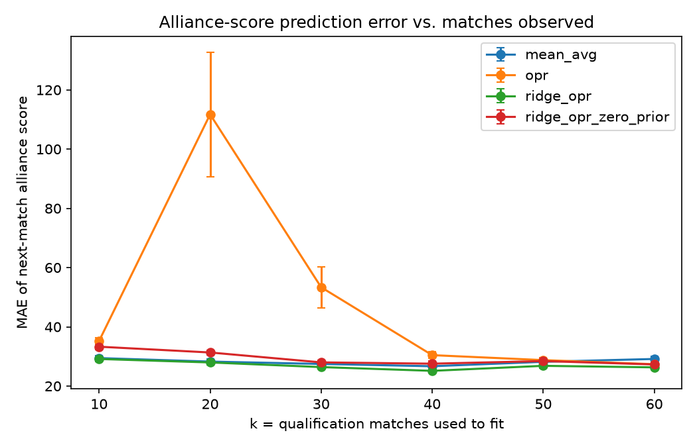

# Robot Compatibility Matching

An Android scouting app for the FRC *Infinite Recharge* game, plus an analytics layer for
choosing alliance partners: robot contribution estimates (OPR), complementary k-NN
matching, and a backtest on real historical events.

## Problem

At alliance selection, a captain picks partners from about 40 teams with little time and
noisy information. Ranking by raw score rewards robots that duplicate what the captain
already does. The goal is to rank partners by how well they **fill the captain's gaps**,
using scouting data and public match data, and to check honestly whether that beats simpler
baselines on past events.

## Repo layout

```
app/                    Android app (Java, SQLite)
analytics/
  tba.py                TBA API v3 client with on-disk cache
  data.py               normalize matches and alliances
  opr.py                OPR, component OPR, ridge OPR, MAE-vs-k evaluation
  features.py           feature vectors, shrinkage, z-scoring
  matching.py           complementary k-NN, baselines, live Draft state
  backtest.py           simulation, metrics, bootstrap CIs
  export.py             model_params.json, snapshot CSV, Python reference session
tests/                  pytest tests; fixtures/ are SYNTHETIC (see tests/fixtures/README.md)
reports/                generated tables (data_counts.md / .json after `make data`)
Makefile                setup, data, opr-eval, backtest, export, test
pyproject.toml          pinned Python dependencies
```

Planned, not yet present: nothing from the PRD's file list.

## Android app

Scouts step through five screens per match: pre-match (team, match), autonomous,
teleop, post-match, then save/export.

- One `MatchRecord` object is carried through the whole flow. Back-navigation keeps entered
  data, and the record survives rotation and process death. This replaces the old public
  static fields.
- Every wheel checkbox combination maps to a defined value (bitmask: none 0, spin 1,
  color 2, both 3).
- New fields: **defense rating** (0 none, 1 light, 2 medium, 3 heavy, scout-judged) and
  **defended against**.
- Team and match number are required, counts must be non-negative, outcome is chosen from
  W/D/L, and **total points are calculated** from components (scoring constants are in
  `MatchRecord.java` and should be checked against the game manual).
- SQLite schema v2 migrates v1 data in place instead of dropping the table.
- No runtime permissions. **Export** goes through the Android share sheet, **import** uses
  the system file picker. Importing skips exact duplicate rows, so several scouting tablets
  can be merged on one device.
- Toolchain: AGP 8.5.2, Gradle 8.7, compileSdk/targetSdk 34, min SDK 24, Java 17.

Run the tests (needs Android Studio / the Android SDK):

```
./gradlew testDebugUnitTest            # MatchRecord and CSV codec
./gradlew connectedDebugAndroidTest    # Espresso scouting-flow test (device or emulator)
```

Known limitations: going Back from the data screen and submitting again saves a second
copy of the match; the v1 to v2 database migration has not been tested on a real v1 file.

## Alliance Selection
The app ranks partners fully offline using the same logic as the Python reference. Pieces:

- `model_params.json` (versioned, `schema_version` 1) holds feature names, distance weights,
  the winning profile, the scouting shrinkage prior and the normalization rule.
  `make export` writes it to `app/src/main/assets/` from a real fit (after `make data`).
  The committed file comes from the real 2020 fit; re-run `make export` to refresh it.
- A **TBA snapshot** CSV of raw per-team ratings, made with
  `make export ARGS="--snapshot 2020xxxx"` (writes `reports/snapshot_2020xxxx.csv`) and imported
  in the app. It is stored in SQLite (database v3), so the screen works offline afterwards.
- Local scouting data from the scouting screens feeds the scouting features when the model uses them.
- Screen: enter your team, tap *Rank partners*, then *Pick* (ours) or *Gone* (taken or declined by
  others). The list re-ranks immediately and the target is recomputed after your first pick.
  Each row shows the candidate's z-scored features and which feature fits best or worst.
- Java engine: `ModelParams`, `FeatureBuilder` (shrinkage, z-scoring), `PartnerMatcher`
  (target, distance, `Draft`), `SnapshotCsv`. All plain Java, no Android classes.

**Parity.** `tests/parity_cases.py` runs the Python reference on 5 seeded **synthetic** cases
(TBA-only, with scouting, scouting requested but absent, a NaN rating, feature subset/order) and
saves inputs plus expected output to `tests/fixtures/parity/`. pytest checks the committed files
equal a fresh generation; the Java `ParityTest` must reproduce every z-feature, target, ranking,
distance and per-feature contribution to 1e-9. If you change the Python reference, regenerate with
`python tests/parity_cases.py --write`. Ties are broken by team number in both languages; exact
float ties between different vectors are not covered.

Differences worth knowing: the historical backtest has no scouting data, so fitted models use only
the three Blue Alliance features; scouting features are implemented and parity-tested but only
influence ranking if a future model includes them in `features`. When a requested scouting feature
has no scouting data at all, it is 0 (neutral).

## Data

Source: [The Blue Alliance API v3](https://www.thebluealliance.com/apidocs/v3). Target
seasons are 2020 and 2021 (*Infinite Recharge*). 2021 was mostly the at-home challenge, so
few or no usable events are expected from it.

```
make setup
make data
```

`make data` caches raw JSON in `data/cache/` (git-ignored), normalizes it into
`data/processed/{events,matches,alliances}.csv`, and writes event, match and alliance counts
to `reports/data_counts.md` and `.json`. Event types pulled: regional, district, district
championship, and championship division and finals; offseason, preseason and festival
events are excluded.

Qualification (`qm`) and playoff (`ef`, `qf`, `sf`, `f`) matches are separated by
`qual_matches()` and `playoff_matches()`. Models may only be fit on qualification data;
playoff matches are outcomes for the backtest. A test checks the two sets are disjoint and
cover every played match.

Counts are reported under Results once `make data` has run. The score-breakdown field names (`autoPoints`, `initLineRobot1`, ...) follow
the documented TBA schema and have not yet been verified against a real pull.

## Methods (implemented in `analytics/`)

**OPR.** For one event, each row of the design matrix `A` marks the three robots on one
alliance in one qualification match, and `s` holds that alliance's score. Solve by least
squares:

```
A x ≈ s          x = argmin ||A x − s||²
```

Component OPRs (auto, teleop, endgame points) use the same `A`.

**Ridge OPR.** Early in an event there are few matches per robot and plain OPR is noisy.
Shrink it:

```
x_ridge = (AᵀA + λI)⁻¹ Aᵀ s
```

with λ chosen using only events that started strictly before the event being evaluated
(same k), so there is no look-ahead. The code also evaluates a *centered* variant that shrinks
each robot toward the average robot instead of toward 0 (`x = μ + ridge(s − μ·A1)`, μ from the
fitting rows only). The centered variant is my addition to the PRD formula; both are reported. Evaluation: fit on the first *k* qualification matches, predict the next
matches' alliance scores, and compare mean-score average (a team's average alliance score so
far), OPR and ridge OPR by mean absolute error at several *k*. Run `make opr-eval` after
`make data`; it writes `reports/opr_mae_by_k.{png,csv,md}`.

**Small-sample shrinkage for scouting rates.** A rate observed over *n* matches is pulled
toward the event mean with weight `n / (n + m)`, where *m* is a tunable prior strength.
Every feature is z-scored within the event before distances are computed.

**Complementary k-NN.** Feature weights are learned by regressing playoff alliance
performance on the sum of its members' feature vectors across historical events. The target
partner profile is the average feature vector of historical winning alliances minus the
captain's own vector, clipped at zero. Candidates are ranked by weighted Euclidean distance
to that target (smaller is better). Plain k-NN on the captain's vector would return similar
robots; the target vector is what makes the match complementary. The second pick recomputes
the target after the first pick is added. Baselines: rank by plain OPR, and rank by seeding.

**Backtest** (`make backtest`, after `make data`). Events are processed in date order. For each
event, features, plain OPR and seeding come from that event's qualification matches only, and
λ, the feature weights and the winning profile come only from events that started strictly
earlier. Captains pick in seed order; each captain's pool excludes all alliance captains and the
actual first picks made before them. I interpret the "winning profile" as the average of the
*summed* 3-robot feature vectors of winning alliances, so the per-robot target is
`clip((S − captain − picks so far) / picks remaining, 0)`. Alliance performance (the regression
target and the Spearman target) is mean playoff score per match. Feature weights come from a ridge
regression of that performance on the summed member vectors; negative coefficients get distance
weight 0. Seeding is the official qualification rank (pulled with `make data`). Metrics, per event then averaged over events with bootstrap 95% CIs (fixed seed): Spearman
correlation, across alliances, between the method's percentile rating of the actual first pick and the
alliance's playoff performance; top-3 hit rate; and the predicted strength gap between the method's
#1 recommendation and the real pick (strength = centered ridge OPR, which favors the OPR baseline).
Paired k-NN minus OPR and k-NN minus seeding differences are reported too. The result will be reported honestly even
if complementary k-NN does not beat plain OPR.

## Results

Everything between the markers below is generated by `make report` from `reports/` and
`docs/screenshots/`. CI fails if it is out of date, so no number here is typed by hand.

<!-- RESULTS:START (generated by `make report`; do not edit by hand) -->

### Data pulled

| Quantity | Count |
|---|---|
| events listed | 201 |
| events with matches | 52 |
| events per year | {'2020': 52} |
| qualification matches | 3806 |
| playoff matches | 828 |
| alliances | 416 |
| ranking rows | 2074 |
| unplayed or malformed matches skipped | 0 |

### Alliance-score prediction error versus matches observed

Mean absolute error of next-match alliance score predictions; SE is across events.

| k | method | mean MAE | SE | events |
|---|---|---|---|---|
| 10 | mean_avg | 29.45 | 0.84 | 51 |
| 10 | opr | 35.22 | 1.18 | 51 |
| 10 | ridge_opr | 29.14 | 0.87 | 51 |
| 10 | ridge_opr_zero_prior | 33.29 | 0.97 | 51 |
| 20 | mean_avg | 28.26 | 0.80 | 51 |
| 20 | opr | 111.73 | 21.02 | 51 |
| 20 | ridge_opr | 27.97 | 0.76 | 51 |
| 20 | ridge_opr_zero_prior | 31.33 | 0.79 | 51 |
| 30 | mean_avg | 27.46 | 0.68 | 51 |
| 30 | opr | 53.35 | 6.93 | 51 |
| 30 | ridge_opr | 26.40 | 0.69 | 51 |
| 30 | ridge_opr_zero_prior | 27.99 | 0.78 | 51 |
| 40 | mean_avg | 26.69 | 0.71 | 50 |
| 40 | opr | 30.44 | 1.10 | 50 |
| 40 | ridge_opr | 25.14 | 0.68 | 50 |
| 40 | ridge_opr_zero_prior | 27.55 | 0.85 | 50 |
| 50 | mean_avg | 28.19 | 0.91 | 39 |
| 50 | opr | 28.76 | 0.86 | 39 |
| 50 | ridge_opr | 26.83 | 0.86 | 39 |
| 50 | ridge_opr_zero_prior | 28.43 | 0.88 | 39 |
| 60 | mean_avg | 29.15 | 0.86 | 32 |
| 60 | opr | 27.38 | 0.84 | 32 |
| 60 | ridge_opr | 26.32 | 0.77 | 32 |
| 60 | ridge_opr_zero_prior | 27.29 | 0.83 | 32 |



### Backtest

Means over events with bootstrap 95% confidence intervals (fixed seed).

| metric | method | mean | 95% CI | events |
|---|---|---|---|---|
| spearman | knn | -0.174 | [-0.265, -0.079] | 46 |
| spearman | opr | 0.381 | [0.284, 0.470] | 46 |
| spearman | seeding | 0.298 | [0.209, 0.390] | 46 |
| spearman | knn - opr | -0.554 | [-0.673, -0.439] | 46 |
| spearman | knn - seeding | -0.471 | [-0.573, -0.366] | 46 |
| top3 | knn | 0.526 | [0.473, 0.579] | 46 |
| top3 | opr | 0.700 | [0.658, 0.741] | 46 |
| top3 | seeding | 0.684 | [0.638, 0.728] | 46 |
| top3 | knn - opr | -0.174 | [-0.226, -0.120] | 46 |
| top3 | knn - seeding | -0.158 | [-0.217, -0.095] | 46 |
| gap | knn | -2.053 | [-2.870, -1.267] | 46 |
| gap | opr | 4.677 | [3.958, 5.476] | 46 |
| gap | seeding | -1.084 | [-1.823, -0.348] | 46 |
| gap | knn - opr | -6.730 | [-7.840, -5.792] | 46 |
| gap | knn - seeding | -0.969 | [-2.167, 0.212] | 46 |

Paired comparisons (computed from the table above):

- Spearman correlation, k-NN minus plain OPR: -0.554 (95% CI [-0.673, -0.439], 46 events): complementary k-NN is worse.
- Spearman correlation, k-NN minus seeding: -0.471 (95% CI [-0.573, -0.366], 46 events): complementary k-NN is worse.
- top-3 hit rate, k-NN minus plain OPR: -0.174 (95% CI [-0.226, -0.120], 46 events): complementary k-NN is worse.
- top-3 hit rate, k-NN minus seeding: -0.158 (95% CI [-0.217, -0.095], 46 events): complementary k-NN is worse.

### Fitted feature weights

| feature | regression coefficient | distance weight | winning-profile component |
|---|---|---|---|
| auto_opr | 4.9803 | 0.2276 | 2.5060 |
| teleop_opr | 16.8983 | 0.7724 | 3.3746 |
| endgame_opr | -6.1991 | 0.0000 | 2.2517 |

Fitted on all events, so descriptive only; the backtest never uses these.

<!-- RESULTS:END -->

## Reproduce

```
make setup
make all                             # data, opr-eval, backtest, export, report
make test                            # pytest (Python + parity fixture check)
```

`make all` rewrites `reports/`, `app/src/main/assets/model_params.json` and the results block above.
Raw API responses are cached in `data/cache/`, so re-runs revalidate instead of re-downloading;
delete that folder for a fully clean pull. The bootstrap seed is fixed. For the app, import a
snapshot made with `make export ARGS="--snapshot EVENT_KEY"` (see Alliance Selection).

CI (`.github/workflows/ci.yml`) runs pytest and the Android JVM unit tests on every push. The
Espresso scouting-flow test needs a device or emulator and is run locally with
`./gradlew connectedDebugAndroidTest`.

## Limitations

- Total-point scoring constants in the app are assumptions pending a check against the
  game manual.
- OPR assumes alliance scores are the sum of independent robot contributions, which
  ignores synergy and defense; defense enters only through scouting data.
- Scouting features exist only for events scouted with this app, so the historical
  backtest can use TBA-derived features only.